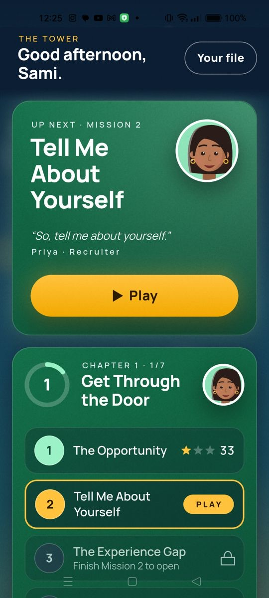
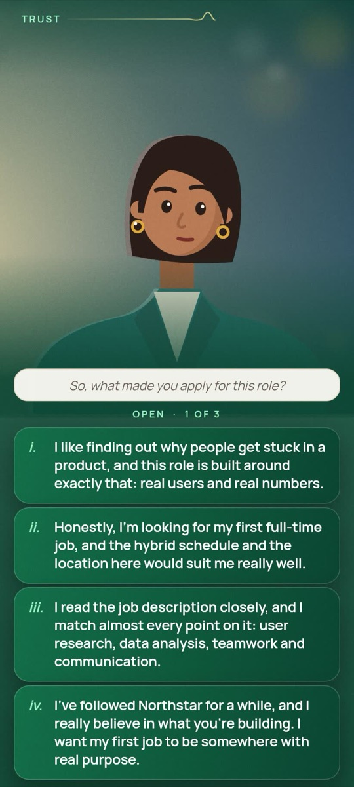
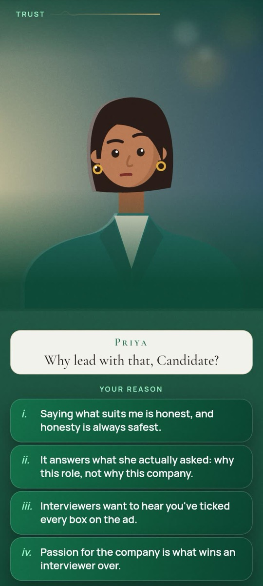
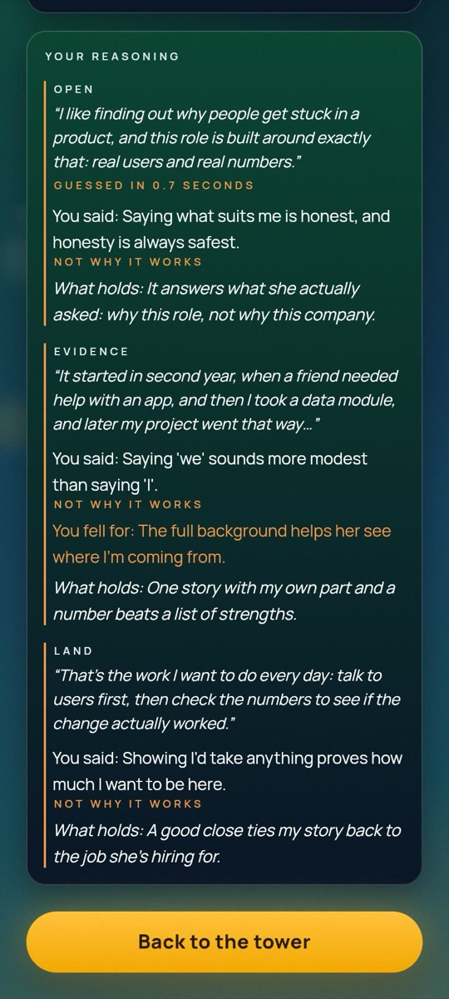
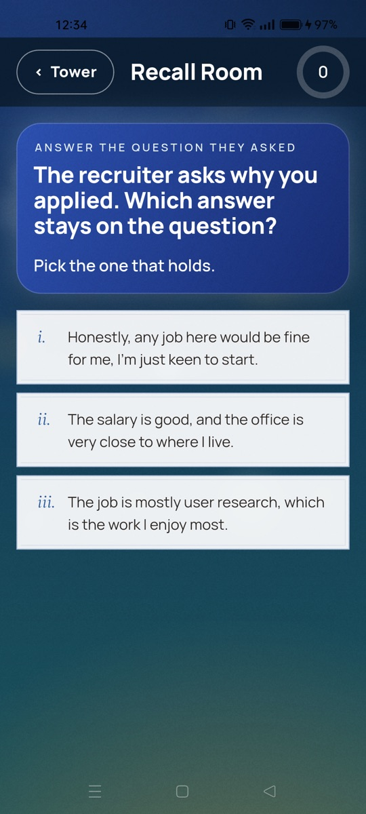

# The Last Room

> One room left between you and the offer.

**An interview-practice game that plays like a film.** You're a graduate with little
experience, interviewing for a Product Associate role at a fictional company, Northstar Labs.
Each mission is one interview question. You build your answer in three beats (open, evidence,
land), say **why** you chose each line, and the interviewer reacts, pushes back with a
follow-up, and hands you a debrief that shows exactly what made your answer stronger or weaker.
Then the **Recall Room** brings back every trap you fell for until it stops catching you.

Built in Flutter for Android, iOS and the web, for a product assessment by
[8x](https://github.com/8xsocial). **▶ Demo video:** _coming soon_ · **Android APK:** see
[Releases](https://github.com/samiarif02/thelastroom/releases) · **Submission notes:**
[`docs/SUBMISSION.md`](docs/SUBMISSION.md)

| The tower | Build the answer | Say why | The debrief | Recall Room |
| :---: | :---: | :---: | :---: | :---: |
|  |  |  |  |  |

## Run it (3 commands)

You need Flutter **3.47.8** (stable). No keys, no env file, no network: the game plays fully
offline.

```bash
git clone https://github.com/samiarif02/thelastroom && cd thelastroom
flutter pub get
cd apps/mobile && flutter run        # a phone or emulator; add -d chrome for the web
```

`npm install` (Node 22+) is only needed to develop: it installs the git hooks that run the
gates. The optional backend (sign-in, sync, AI scoring) is described below.

## Why it's built this way

Most people practise interviews by reading "top 50 answers". The Last Room teaches by playing:
short missions, wrong answers that are **realistic mistakes rather than jokes**, follow-ups that
punish vagueness, and spaced recall of what you missed. It's for students, fresh graduates,
career changers and non-native English speakers.

**It can't be played on autopilot.** In the owner's first playtest, tapping at random still earned
a score, so the game is now built against it:
- a pick made in under 1.5 seconds is a **guess** and scores 0 for that beat;
- after each pick the interviewer asks **"Why that line?"**, with principles to choose from,
  not paraphrases of the line;
- picking the strongest line for the wrong principle keeps only 60% of its points (the player
  got lucky);
- every weak line is tied to the misconception that tempts people into it, so the debrief says
  "You fell for: …" and the Recall Room drills it.

## How the score works

There are two scorers, and the dossier always says which one it shows.

1. **Online: an AI senior recruiter (Google Gemini).** When the optional backend is running, the
   debrief sends the answer the player built (game content only: never their name or anything
   they typed) to a Supabase Edge Function. The function asks Gemini, as a senior recruiter, to
   grade relevance, specificity, structure and adaptability 0–100, each with **one sentence of
   basis**.
   - **Why:** reviewers asked "on what basis are you scoring?", and a recruiter's reasoned
     judgement answers that better than numbers the author fixed in advance.
   - **Safeguards:** temperature 0 and a JSON schema, validated on the server, 30 scores per
     player per day, and an 8-second timeout. The key never leaves the server.
   - [ADR 0006](docs/decisions/0006-ai-scoring.md) has the details.
2. **Offline: the rule-based engine** (`packages/engine`, pure Dart), labelled "Offline score".
   It's shown whenever there's no backend, no network, a timeout or a spent quota.
   - **How it scores:** each answer line is scored 0–3 on four dimensions by the content
     author, then weighted (relevance 25%, specificity 30%, structure 25%, adaptability 20%).
   - **Structure** is the answer's weakest beat, not the average.
   - **Guesses and reasons** count as above.
   - **What else it drives:** it's deterministic and fully unit-tested. It also picks the
     follow-up, moves the trust meter, marks the costliest line in red pen and schedules recall
     cards ([ADR 0003](docs/decisions/0003-deterministic-scoring-and-ai-coach.md),
     [FR-20–26](docs/requirements.md)).

Progress over time (the Mission 1 baseline, the skills radar) uses the engine's scores, because
they can be recomputed exactly from the stored picks.

## Architecture at a glance

```
apps/mobile/        Flutter app: the tower, missions, debrief, Recall Room, sound, settings
packages/engine/    pure Dart: scoring, guesses and reasons, follow-ups, Leitner recall
packages/content/   7 missions, interviewers, lessons as typed Dart, validated in tests
packages/brand/     design tokens and theme (the only place a colour is written)
supabase/           migrations with tested owner-only RLS, the `score` Edge Function (Gemini)
docs/               brief, requirements, ADRs, rules, briefs, status, memory
.claude-logs/       the Claude Code transcripts behind every change
```

| Decision | Why | ADR |
| --- | --- | --- |
| Flutter widgets, not a game engine | Cinematic UI, accessibility and the web from one codebase | [0001](docs/decisions/0001-flutter-widgets-not-flame.md) |
| Offline-first: local SQLite (drift) plus an idempotent outbox | The game never waits on the network; sync is a backup | [0002](docs/decisions/0002-offline-first-outbox.md) |
| A deterministic engine for scoring | Reproducible, explainable, works offline | [0003](docs/decisions/0003-deterministic-scoring-and-ai-coach.md) |
| Local notifications only | No push infrastructure for v1 | [0004](docs/decisions/0004-local-notifications.md) |
| Zero setup; the backend is optional | Clone and run, no keys | [0005](docs/decisions/0005-zero-setup-offline-backend-optional.md) |
| An AI recruiter scores online, the engine offline | A stated basis for every number | [0006](docs/decisions/0006-ai-scoring.md) |

Every change went through a PR with green CI: secrets scan, standards checks, format, strict
analysis, event registry, env, RLS, every package's tests (plus Linux golden images), the web
build, and pgTAP RLS tests on a fresh database. Rules for people and agents are in
[`AGENTS.md`](AGENTS.md), ported from 8x's [template](https://github.com/8xsocial/template-web)
standards to Flutter (the divergences are listed there).

## Honest limits

- **Chapter 1 only.** Seven missions are playable; Chapters 2 and 3 are visible, locked
  teasers.
- **It teaches choosing, not speaking.** Picking from written lines isn't answering live, and a
  free-text answer mode isn't built.
- **The scoring weights are a hypothesis.** They'd need human-rated answers to validate, and
  the AI's score isn't perfectly reproducible (temperature 0 narrows it but doesn't remove it).
- **AI scoring needs a laptop.** Nothing is hosted, so the AI recruiter runs on a Mac on the
  same Wi-Fi (below). Without it, the game uses the offline score.
- **AI scoring is verified with a mocked Gemini** (15 Deno tests and the app's fallback tests);
  the live run with a real key on a phone hasn't been done yet.
- **Not in stores.** The APK is signed with the debug key, which is fine for installing
  directly, not for Google Play. The game has been played on Android (a realme 8) and in Chrome;
  iOS hasn't been tested.
- **Reminders are Android-first.** The local "traps waiting" and in-character nudges are built
  and tested; on iOS they're wired but untested, and the web has none (FR-50–53).
- No job is promised: story outcomes are narrative, not predictions.

## Optional: the backend and AI scoring

**Sign-in and sync.** Give the app public Supabase config, then run it with the defines:

```bash
cp apps/mobile/env/dev.example.json apps/mobile/env/dev.json    # public config only
cd apps/mobile && flutter run --dart-define-from-file=env/dev.json
```

With no keys, or keys but no network, every backend feature is silently off
([ADR 0005](docs/decisions/0005-zero-setup-offline-backend-optional.md)).

**AI scoring on your Mac** (a phone on the same Wi-Fi reaches it):

1. **Key:** `cp .env.example .env` and set `GEMINI_API_KEY=`. It stays on the server; the app
   never sees it.
2. **Backend:** `supabase start`, then `supabase functions serve score --env-file .env`, and
   leave it running. `supabase status` prints the local anon key, which is public.
3. **App:** in `apps/mobile/env/dev.json`, set `SUPABASE_URL` to
   `http://<your Mac's LAN IP>:54321` (`ipconfig getifaddr en0` on macOS) and
   `SUPABASE_ANON_KEY` to that anon key. Then run with `--dart-define-from-file=env/dev.json`.

Debug and profile builds may use plain HTTP on the LAN; release builds are HTTPS-only. If the
Mac is off, the Wi-Fi drops, or the panel takes more than 8 seconds, the debrief shows the
offline score.

## Develop

```bash
npm install            # installs the git hooks (no npm dependencies)
npm run check:secrets && npm run check:standards && npm run format:check && npm run analyze \
  && npm run check:events && npm run check:env && npm run check:rls && npm run test \
  && npm run build:web # what CI runs on every PR, in its order
```

The release APK is built by the **Release APK** workflow (`.github/workflows/release-apk.yml`,
run by hand or by a `v*` tag), which attaches it to a **draft** GitHub release. Locally:
`cd apps/mobile && flutter build apk --release`.

## Credits

- Fonts: [Cormorant Garamond](https://github.com/CatharsisFonts/Cormorant) and
  [Manrope](https://github.com/sharanda/manrope), SIL Open Font License (bundled with their
  `OFL.txt` in `packages/brand/fonts/`).
- Sounds: all synthesised in this repo, CC0; every file is listed in
  [`docs/audio-credits.md`](docs/audio-credits.md).
- Interviewers and scenes: drawn in code (`apps/mobile/lib/ui/figure/`), no image assets.
