# The Last Room

> One room left between you and the offer.

**An interview-practice game that plays like a film.** You're a graduate with little
experience, interviewing for a Product Associate role at a fictional company, Northstar Labs.
Each mission is one interview question. You build your answer in three beats (open, evidence,
land), say **why** you chose each line, and the interviewer reacts, pushes back with a
follow-up, and hands you a debrief that shows exactly what made your answer stronger or weaker.
Then the **Recall Room** brings back every trap you fell for until it stops catching you.
**Chapter 2** is answered out loud: the interviewer speaks, you record, and the AI recruiter
scores what you said, never how you sound. **Chapter 3** mixes both. Every mission says what
it practises before it starts.

Built in Flutter for Android, iOS and the web, for a product assessment by
[8x](https://github.com/8xsocial).

**Landing page:** [thelastroom-ten.vercel.app](https://thelastroom-ten.vercel.app) ·
**Android APK:** see [Releases](https://github.com/samiarif02/thelastroom/releases) ·
**Submission notes:** [`docs/SUBMISSION.md`](docs/SUBMISSION.md) ·
**What's built and what isn't:** [`docs/completion.md`](docs/completion.md)

| The tower | Build the answer | Say why | The debrief | Recall Room |
| :---: | :---: | :---: | :---: | :---: |
| 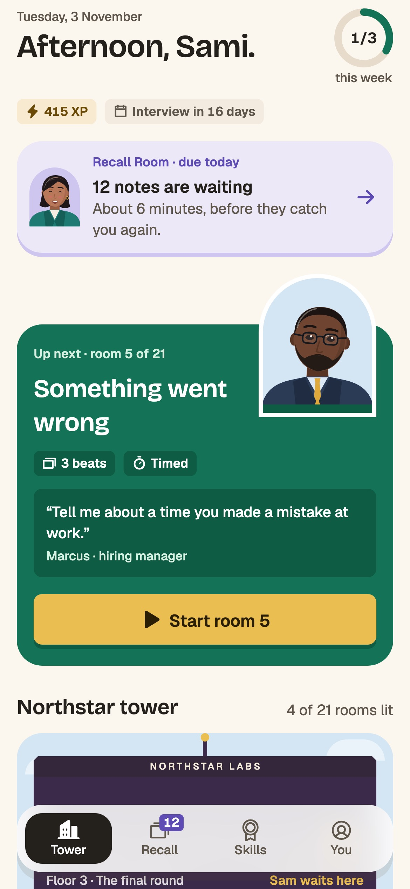 | 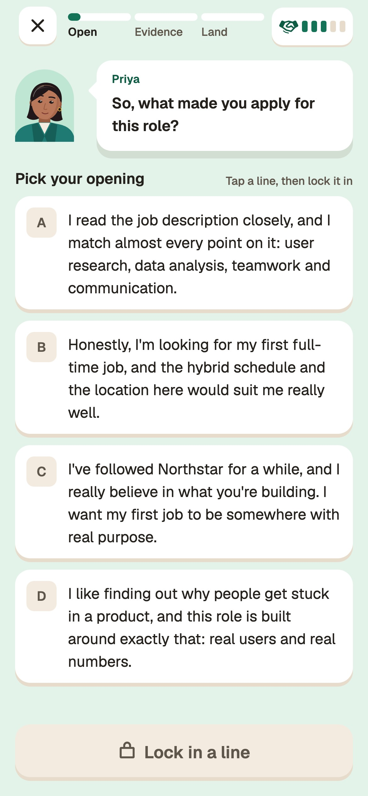 | 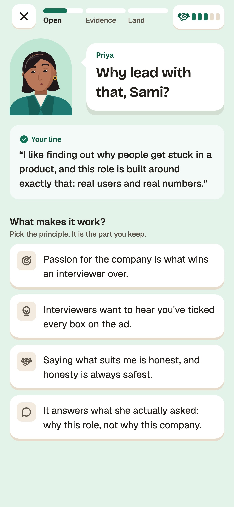 | 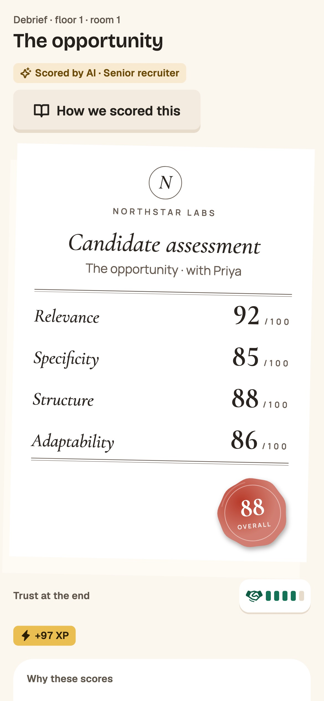 | 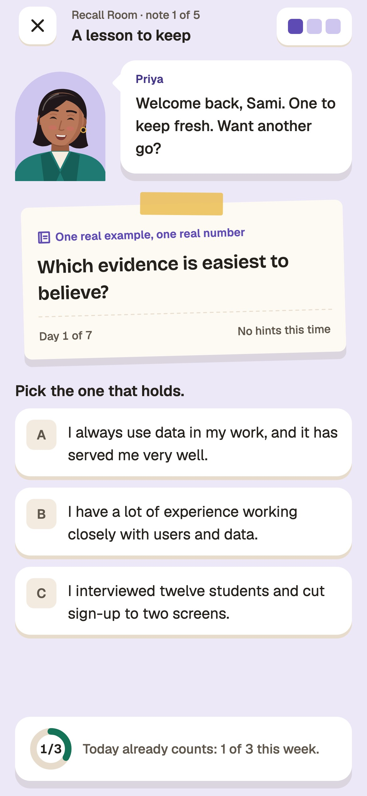 |

| Doors to every room | A floor's sheet | Answer out loud | Your file | A past result |
| :---: | :---: | :---: | :---: | :---: |
| 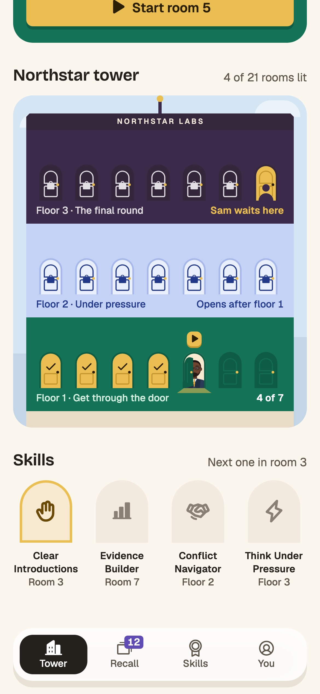 | 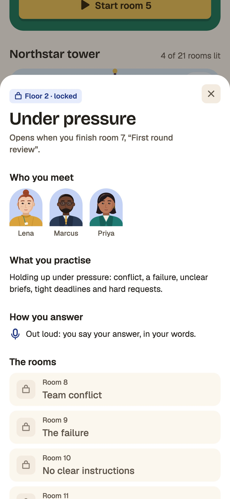 | 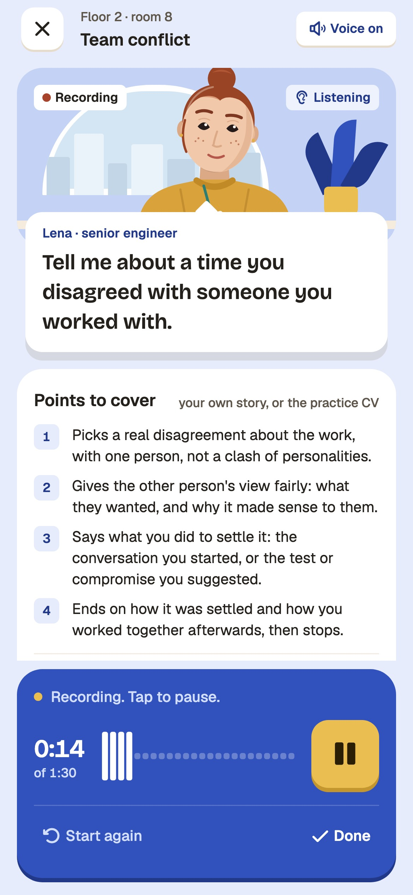 | 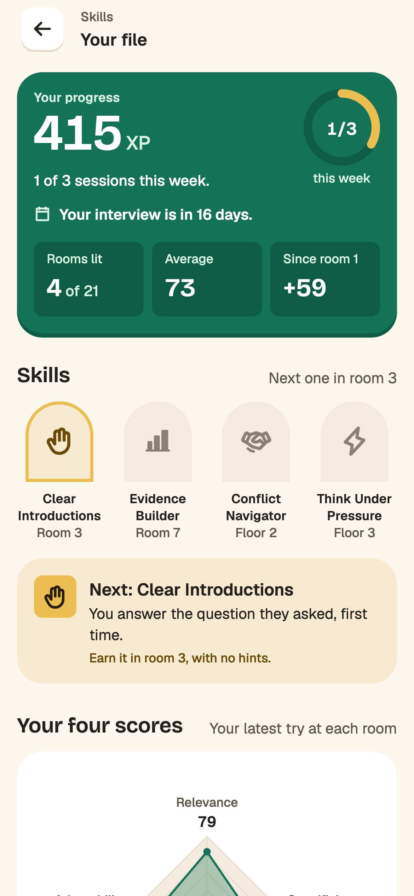 | 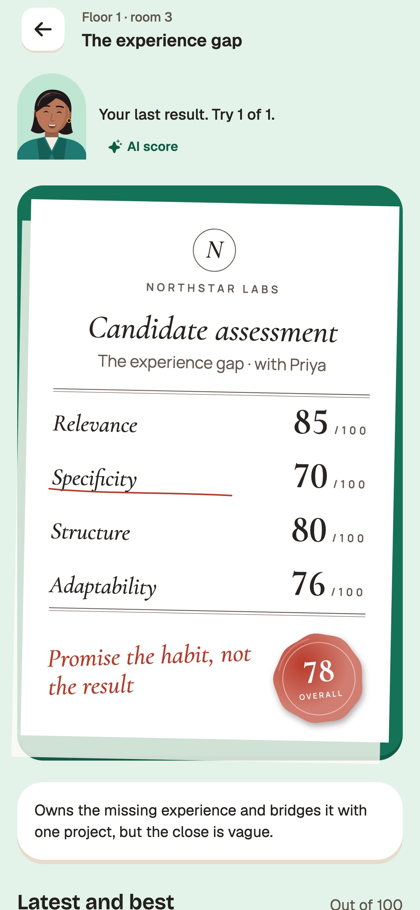 |

| Why these scores | Floor cleared | The title | Onboarding | First-time tip |
| :---: | :---: | :---: | :---: | :---: |
| 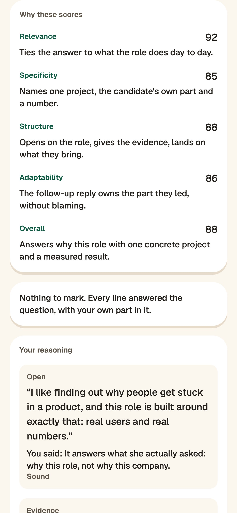 | 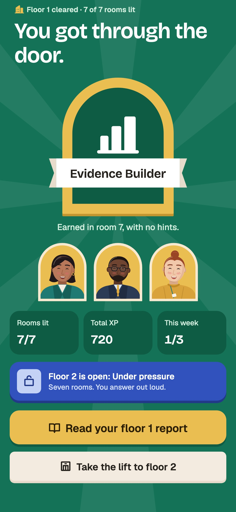 | 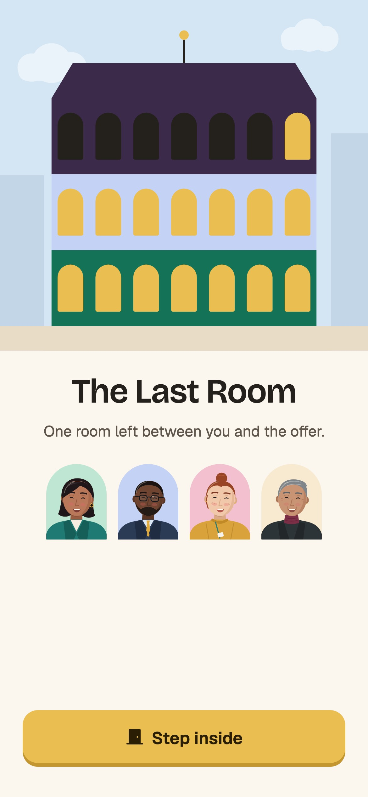 | 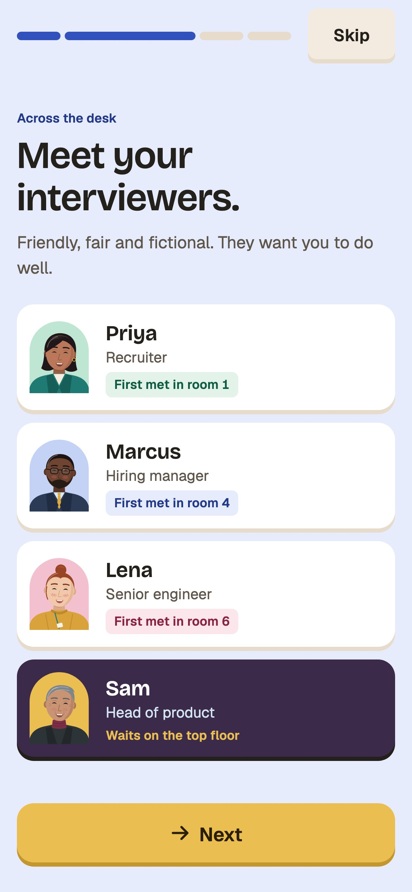 | 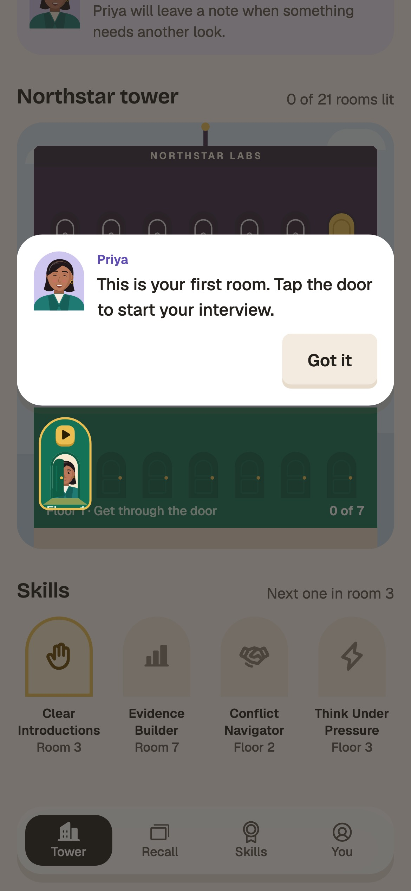 |

The screenshots are widget-test stills of the real screens with seeded progress, at 390 × 844
(`apps/mobile/test/app/stills/readme_stills_test.dart`; `WRITE_STILLS=1` writes them again).

## What's in the game

- **Three floors, 21 rooms.** Floor 1, *Get through the door*: seven rooms answered by building
  the answer from lines. Floor 2, *Under pressure*: seven rooms, **all answered out loud**.
  Floor 3, *The final round*: mixed, three built from lines and four spoken, ending with Sam.
- **Build, then say why.** Three beats (open, evidence, land), every option a realistic
  mistake or the strong line; after each pick, "Why that line?" with principles to choose from.
- **Voice.** The interviewer's lines are spoken; you record, recording pauses itself after
  5 seconds of silence, Continue picks up, Start again throws the take away. The audio is sent
  for scoring and never stored.
- **Live AI scoring, with an offline fallback.** With the optional backend, an AI senior
  recruiter (Gemini) scores each answer with one sentence of basis per number; without it, the
  game's own engine scores, labelled "Offline score". How well the AI scores is
  [published](docs/scoring-eval.md).
- **The debrief** is the *Candidate assessment* sheet: four scores, a wax seal, the costliest
  line in red pen, "Why these scores", "Your reasoning" and "How we scored this".
- **Recall Room.** Every trap you fell for comes back as a note on a Leitner schedule (boxes at
  1, 3 and 7 days) until it stops catching you.
- **Progress you can see.** The Northstar tower with a door per room, XP, a weekly ring (never
  a streak to lose), skills earned without hints, Your file with every past result, the
  Chapter 1 report, and a floor-cleared reward.
- **Coming back.** Local reminders in the interviewers' voices on days 1, 3, 5 and 8 after you
  play (never after 21:00, at most one a day, one switch to turn them off), a welcome-back card,
  and Settings → "Send a test reminder".
- **First-time tips**, one at a time where you need them (the first door, the answer cards, the
  why step, the first result, the microphone, Recall, Your file), and **route transitions**:
  the room opens from the door you tapped, pages slide and fade, back controls answer the tap.

## Run it (3 commands)

You need Flutter **3.47.8** (stable). No keys, no env file, no network: the game plays fully
offline.

```bash
git clone https://github.com/samiarif02/thelastroom && cd thelastroom
flutter pub get
cd apps/mobile && flutter run        # a phone or emulator; add -d chrome for the web
```

`npm install` (Node 22+) is only needed to develop: it installs the git hooks that run the
gates. The optional backend (sign-in, sync, AI scoring) is described below.

## Why it's built this way

Most people practise interviews by reading "top 50 answers". The Last Room teaches by playing:
short missions, wrong answers that are **realistic mistakes rather than jokes**, follow-ups that
punish vagueness, and spaced recall of what you missed. It's for students, fresh graduates,
career changers and non-native English speakers.

**It can't be played on autopilot.** In the owner's first playtest, tapping at random still earned
a score, so the game is now built against it:
- a pick made in under 1.5 seconds is a **guess** and scores 0 for that beat;
- after each pick the interviewer asks **"Why that line?"**, with principles to choose from,
  not paraphrases of the line;
- picking the strongest line for the wrong principle keeps only 60% of its points (the player
  got lucky);
- every weak line is tied to the misconception that tempts people into it, so the debrief says
  "You fell for: …" and the Recall Room drills it.

## How the score works

There are two scorers, and the dossier always says which one it shows.

1. **Online: an AI senior recruiter (Google Gemini).** When the optional backend is running, the
   debrief sends the answer the player built (game content only: never their name or anything
   they typed) to a Supabase Edge Function. The function asks Gemini, as a senior recruiter, to
   grade relevance, specificity, structure and adaptability 0–100, each with **one sentence of
   basis**.
   - **Why:** reviewers asked "on what basis are you scoring?", and a recruiter's reasoned
     judgement answers that better than numbers the author fixed in advance.
   - **Safeguards:** temperature 0 and a JSON schema, validated on the server, 30 scores per
     player per day. The key never leaves the server.
   - **Models:** a chain, `gemini-3.5-flash-lite` then `gemini-3.6-flash` then
     `gemini-3.1-flash-lite`, all with minimal thinking: when one is overloaded or slow, the next
     grades, and the verdict records which one did. The player sees the offline score at 8 s if
     the verdict isn't back yet, and the verdict replaces it when it lands (up to 30 s).
   - [ADR 0006](docs/decisions/0006-ai-scoring.md) has the details.
2. **Offline: the rule-based engine** (`packages/engine`, pure Dart), labelled "Offline score".
   It's shown whenever there's no backend, no network, a timeout or a spent quota.
   - **How it scores:** each answer line is scored 0–3 on four dimensions by the content
     author, then weighted (relevance 25%, specificity 30%, structure 25%, adaptability 20%).
   - **Structure** is the answer's weakest beat, not the average.
   - **Guesses and reasons** count as above.
   - **What else it drives:** it's deterministic and fully unit-tested. It also picks the
     follow-up, moves the trust meter, marks the costliest line in red pen and schedules recall
     cards ([ADR 0003](docs/decisions/0003-deterministic-scoring-and-ai-coach.md),
     [FR-20–26](docs/requirements.md)).

Progress over time (the Mission 1 baseline, the skills radar) uses the engine's scores, because
they can be recomputed exactly from the stored picks.

**On the debrief, "How we scored this"** tells the player, for their own answer: what the mission
practised, who scored it, the four dimensions and their weights, the recruiter's score beside the
game's, and what the recruiter is and isn't told.

**How we know the AI scores well:** [`docs/scoring-eval.md`](docs/scoring-eval.md). A test set of
strong, weak and guessed answers for every Chapter 1 mission (built by the app's own request
builder, `supabase/eval/score/`) is scored several times each against the live function; the
report gives how often the AI lands in the band the author intended, whether it ranks strong above
weak and guessed, how much a score moves between repeat runs, and how closely it agrees with the
engine. Re-run it after any change to the prompt or the models (`node supabase/eval/score/run.mjs`).

## Architecture at a glance

```
apps/mobile/        Flutter app: the tower, missions, debrief, Recall Room, sound, settings
packages/engine/    pure Dart: scoring, guesses and reasons, follow-ups, Leitner recall
packages/content/   21 missions (3 chapters), interviewers, lessons as typed Dart, validated
packages/brand/     Daylight Tower tokens, theme, fonts and the cast (the only place a colour is written)
supabase/           migrations with tested owner-only RLS, the `score` and `score-voice` Edge
                    Functions (Gemini), the scoring eval set
web/                the landing page: a static Next.js site, hosted on Vercel (ADR 0007)
docs/               brief, requirements, ADRs, rules, briefs, status, memory
.claude-logs/       the Claude Code transcripts behind every change
```

| Decision | Why | ADR |
| --- | --- | --- |
| Flutter widgets, not a game engine | Cinematic UI, accessibility and the web from one codebase | [0001](docs/decisions/0001-flutter-widgets-not-flame.md) |
| Offline-first: local SQLite (drift) plus an idempotent outbox | The game never waits on the network; sync is a backup | [0002](docs/decisions/0002-offline-first-outbox.md) |
| A deterministic engine for scoring | Reproducible, explainable, works offline | [0003](docs/decisions/0003-deterministic-scoring-and-ai-coach.md) |
| Local notifications only | No push infrastructure for v1 | [0004](docs/decisions/0004-local-notifications.md) |
| Zero setup; the backend is optional | Clone and run, no keys | [0005](docs/decisions/0005-zero-setup-offline-backend-optional.md) |
| An AI recruiter scores online, the engine offline | A stated basis for every number | [0006](docs/decisions/0006-ai-scoring.md) |
| A static landing page on Vercel; the game itself stays unhosted | People who never clone the repo get a page; zero setup is untouched | [0007](docs/decisions/0007-landing-page-on-vercel.md) |

Every change went through a PR with green CI: secrets scan, standards checks, format, strict
analysis, event registry, env, RLS, every package's tests (plus Linux golden images), the web
build, the landing page's lint, typecheck and build, and pgTAP RLS tests on a fresh database. Rules for people and agents are in
[`AGENTS.md`](AGENTS.md), ported from 8x's [template](https://github.com/8xsocial/template-web)
standards to Flutter (the divergences are listed there).

## Honest limits

- **Speaking is scored on content only.** Chapters 2 and 3 score what you said from a
  transcript; pace, fillers and confidence aren't measured (by design: never accent). Offline,
  a spoken answer is scored by your own self-check against the mission's points.
- **The scoring weights are a hypothesis.** They'd need human-rated answers to validate, and
  the AI's score isn't perfectly reproducible (temperature 0 narrows it but doesn't remove it).
- **AI scoring needs a backend.** A clone still runs with none, fully offline, by design
  ([ADR 0005](docs/decisions/0005-zero-setup-offline-backend-optional.md)). The owner's builds
  point at a hosted Supabase project (free tier, since 4 Nov,
  [ADR 0008](docs/decisions/0008-hosted-backend-for-the-owners-builds.md)), so live AI works on
  any network; anyone else runs the same backend on a laptop (below). Without one, the game uses
  the offline score. Live AI scoring was checked on a release build
  on a realme 8 over USB (rooms 2, 5, 6 and 7 scored 92, 90, 85 and 82), and with mocked
  Gemini in 15 Deno tests and the app's fallback tests.
- **The Gemini key is on the free tier**, so heavy use hits rate limits and the game falls back
  to the offline score. Real use needs billing on the key.
- **Not in stores.** The APK is signed with the debug key, which is fine for installing
  directly, not for Google Play. The game has been played through Chapter 1 on Android (a
  realme 8) and in Chrome; iOS hasn't been tested.
- **Predictive back** (the page scrubbing with the back gesture) only exists on Android 14 and
  later; older phones get the same reverse transition on a normal back.
- **Not built:** typed free-text answers. (XP for each explained reason and the shareable
  floor card landed in [#61](https://github.com/samiarif02/thelastroom/pull/61) and
  [#62](https://github.com/samiarif02/thelastroom/pull/62).)
- **Reminders are Android-first.** The local "notes waiting" and in-character nudges are built
  and tested; on iOS they're wired but untested, and the web has none (FR-50–53). They come the
  day after you play, then on days 3 and 5, then day 8, never after 21:00 and at most one a
  day. To see one now on a phone: finish Mission 1, allow notifications, then Settings → "Send
  a test reminder".
- No job is promised: story outcomes are narrative, not predictions.

## Optional: the backend and AI scoring

**Sign-in and sync.** Give the app public Supabase config, then run it with the defines:

```bash
cp apps/mobile/env/dev.example.json apps/mobile/env/dev.json    # public config only
cd apps/mobile && flutter run --dart-define-from-file=env/dev.json
```

With no keys, or keys but no network, every backend feature is silently off
([ADR 0005](docs/decisions/0005-zero-setup-offline-backend-optional.md)).

**AI scoring on your laptop.** You need the Supabase CLI and Docker.

1. **Key:** `cp .env.example .env` and set `GEMINI_API_KEY=` in it. It stays on the server; the
   app never sees it, and `.env` is gitignored.
2. **Backend:** `supabase start` (applies the migrations), then
   `supabase functions serve --env-file <your .env>` (serves `score` and `score-voice`), and
   leave it running. `supabase status` prints the local anon key, which is public.
3. **App:** in `apps/mobile/env/dev.json`, set `SUPABASE_URL` and `SUPABASE_ANON_KEY` (that
   local anon key), then run with `--dart-define-from-file=env/dev.json`:
   - **Chrome or a simulator on the same laptop:** `SUPABASE_URL` is `http://127.0.0.1:54321`.
   - **An Android phone on USB:** run `adb reverse tcp:54321 tcp:54321` (again whenever the
     cable is replugged) and use `http://127.0.0.1:54321`. This works for release builds too,
     because the phone talks to its own loopback.
   - **A phone on the same Wi-Fi:** `http://<the laptop's LAN IP>:54321` (`ipconfig getifaddr
     en0` on macOS). Plain HTTP on the LAN is allowed in debug and profile builds only.

If the backend is off, the cable or Wi-Fi drops, or the panel takes more than 8 seconds, the
debrief shows the offline score (a late verdict still replaces it within 30 s). A spoken answer
falls back to a self-check against the mission's points.

## Develop

```bash
npm install            # installs the git hooks (no npm dependencies)
npm run check:secrets && npm run check:standards && npm run format:check && npm run analyze \
  && npm run check:events && npm run check:env && npm run check:rls && npm run test \
  && npm run build:web # what CI runs on every PR, in its order
```

The release APK is built by the **Release APK** workflow (`.github/workflows/release-apk.yml`,
run by hand or by a `v*` tag), which attaches it to a **draft** GitHub release. Locally:
`cd apps/mobile && flutter build apk --release`.

## Credits

- Fonts: [Bricolage Grotesque](https://github.com/ateliertriay/bricolage),
  [Geist](https://github.com/vercel/geist-font),
  [Cormorant Garamond](https://github.com/CatharsisFonts/Cormorant) (the Candidate assessment
  sheet) and [Manrope](https://github.com/sharanda/manrope), SIL Open Font License, bundled
  with their `OFL.txt` in `packages/brand/fonts/`. Icons: [Phosphor](https://phosphoricons.com),
  MIT.
- Sounds: all synthesised in this repo, CC0; every file is listed in
  [`docs/audio-credits.md`](docs/audio-credits.md).
- Interviewers, the tower and the scenes: drawn in code from shapes in
  `packages/brand/assets/cast/`, no image assets.
