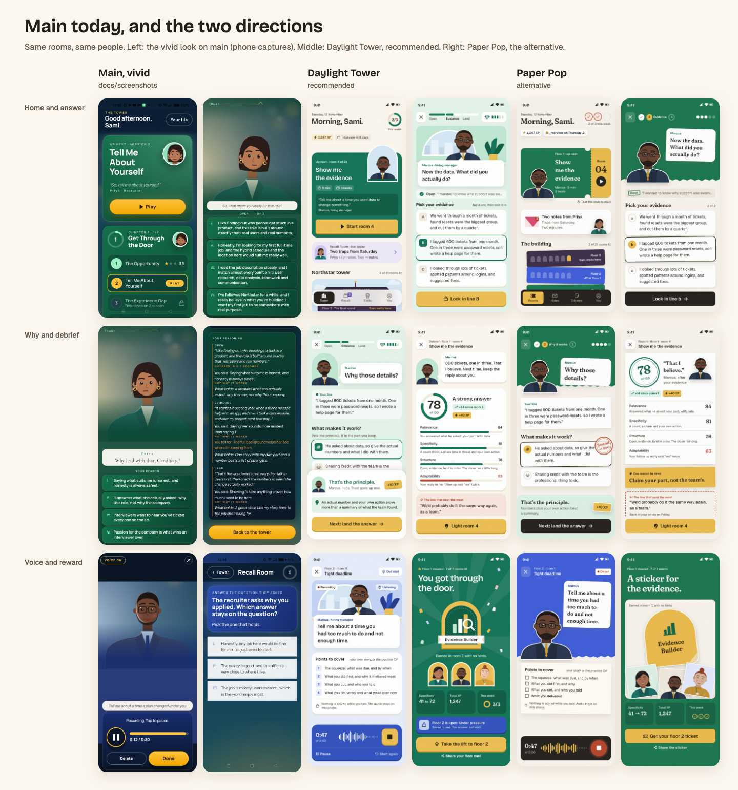

# Design direction: Daylight Tower

Brief 43, phase 2. Research and the diagnosis of main are in [`research.md`](research.md). The
mockups (static HTML, rendered to JPEG at real phone size) are in [`mockups/`](mockups/).

## The recommendation in five lines

1. **Daylight Tower**: keep the vivid look's colour, cast, rings and honey accent, and move it
   into daylight. The grounds are warm paper, the chapter colours are solid floors, and dark
   appears only for the final room at the top.
2. **The people carry the fun; the interface carries the trust.** A redrawn cast with adult faces
   and seven expressions reacts to every choice. Everything else is flat, precise and quiet.
3. **One owned motif, the arched window**, frames the interviewers, the tower's rooms, the skill
   badges and the logo. No stars, no yellow pills, no gradients, no italics.
4. **Bricolage Grotesque for display, Geist for reading.** Every size, space and radius comes
   from the elayadesign skill scales, so the craft holds up on a real phone.
5. **Built for day 3 and day 5**: a weekly ring instead of a streak, Recall notes from the
   interviewer who caught you, rooms that light up, a top floor you can see from day one, and
   celebrations kept for milestones.

Alternative: **Paper Pop** (cut paper, stickers, room tickets, Fraunces). It's more playful and
more editorial, a little less calm. See [the alternative](#the-alternative-paper-pop).



## The mockups

| Screen | Daylight Tower (recommended) | Paper Pop (alternative) |
| --- | --- | --- |
| Home, the tower (a day 3 return, with the welcome-back card) | `mockups/daylight/png/01-home.jpg`, scrolled: `01b-home-tower.jpg` | `mockups/paper/png/01-home.jpg` |
| Answer cards with the interviewer | `02-answer.jpg` | `02-answer.jpg` |
| The "why that line?" step | `03-why.jpg` | `03-why.jpg` |
| Voice recording (chapter 2) | `04-voice.jpg` | `04-voice.jpg` |
| Debrief | `05-debrief.jpg` | `05-debrief.jpg` |
| Reward: floor cleared, skill earned | `06-reward.jpg` | `06-reward.jpg` |
| Recall Room, the day 3 return | `07-recall.jpg` | (same pattern as Daylight, restyled) |
| Landing hero, desktop | `08-landing-hero-1440.jpg` | `07-landing-hero-1440.jpg` |
| Landing hero, phone | `09-landing-hero.jpg` | (stacks like Daylight's) |
| Landing section: tagline reveal and the panel / how it works | `10-landing-section-1440.jpg` | `08-landing-section-1440.jpg` |
| The cast, seven states | `mockups/cast/png/cast-sheet-1440.jpg` | same cast, `paper` style |

Re-render with `node docs/design/mockups/shared/render.mjs <folder> [file.html]`, where
`PUPPETEER_CORE` and `CHROME` point at puppeteer-core and a Chrome binary
(`mockups/shared/env.sh` has this machine's paths). Phone screens render at 390 × 844 @2x, and
desktop at 1440 wide. Every JPEG is under 200 KB.

---

## How the elayadesign skills were applied

The owner asked for [redesign-existing-projects](https://github.com/elayadesign/redesign-skill)
and [landing-page-design](https://github.com/elayadesign/ai-design-skills) (both MIT) to drive the
app and the landing page. The diagnosis is in `research.md`. This is what the direction follows.
When a rule conflicted with the owner's explicit words, the owner won, as the skill itself says.

### Rules followed (app and web)

- **Type scale:** every size is a Tailwind step (12, 14, 16, 18, 20, 24, 30, 36, 48, 60), with
  its paired line height, through the named text styles (Heading 1–6, Title 1–4, Body 1–6,
  Button, Caption 3–4). Flutter has one `TextStyle` per named style, and nothing else is allowed.
- **Weights capped at bold.** Display text is 600, never 800. Medium and semibold carry the
  hierarchy.
- **No italics anywhere.** Quotes are set roman, inside quotation marks.
- **No all-caps subheads.** Kickers are sentence-case Caption 3. The only capitals are the
  "NORTHSTAR LABS" sign drawn on the building, which is illustration.
- **Negative tracking on large type, tabular figures** for every score, XP count and timer.
- **Spacing only from the scale:** 2, 4, 8, 12, 16, 24, 32, 40, 48, 64, 80, 96. The phone
  gutter is 16, card padding is 16, and section gaps are 24.
- **Radius only from Tailwind** (6, 8, 12, 16, 24, full), with the nested formula: a button inside
  a 24 card with 16 of padding gets 8.
- **Flat backgrounds; no gradients.** Depth comes from flat colour blocks, the illustration and
  a 5% grain. The one gradient is the landing hero heading's text, which the skill prescribes.
- **Shadows tinted toward the ground** (`rgb(94 72 40 / …)`), all lit from above. Pressable
  elements carry a hard 4 px edge below instead of a drop shadow.
- **No generic card look.** Cards are white on paper with an edge, never border plus shadow plus
  white. There are no one-sided borders: main's orange left bars in the debrief are gone.
- **No pill badges.** Tags are squared (radius 6). Avatars are arches, not circles.
- **Icons from Phosphor** (regular, bold and fill; `phosphor_flutter` in the app,
  `@phosphor-icons/react` on the web). Material icons are banned.
- **Motion:** the base curve `cubic-bezier(0.22, 1, 0.36, 1)`, 500 ms for movement, 300 ms for
  colour and opacity, never under 200 ms. Only transform and opacity animate. Reduced motion
  swaps movement for a plain fade.
- **States:** hover (web), pressed (`translateY(4px)`, edge collapses), visible focus ring,
  skeleton loading shaped like the screen, composed empty states, specific errors.
- **Content realism:** real copy from the missions, odd numbers (78, +14, 1,247 XP), sentence
  case on headings and buttons, no exclamation marks, calm system messages ("That's the
  principle."), and a verb plus outcome on every CTA ("Start room 4", "Lock in line B",
  "Light room 4", "Take the lift to floor 2").
- **Landing (Part A):** one offer, one audience, one primary action. The headline states the
  outcome and the audience. There's a proof signal above the fold, a risk reversal (no sign-up,
  plays offline, voice never stored), the mandatory tagline reveal section, an FAQ, and a final
  CTA identical to the top one.

### Where a rule conflicts with the owner's brief (the owner wins)

| Skill rule | What we do | Why |
| --- | --- | --- |
| Fonts: Geist, Manrope, Geist Mono or Poppins only | **Geist** for all reading text (an approved font), **Bricolage Grotesque** for display | The brief bans Manrope and Poppins and asks for "a characterful but legible pair". Geist alone reads as generic; the owner said "not generic, not AI generic". |
| One typeface per site | A pair | The brief explicitly asks for a pair, which the skill allows. |
| One accent colour | **One action accent** (honey) plus three chapter colours | The owner asked for colourful and liked the vivid look. Chapter colours are wayfinding (which floor you're on), not accents. Only honey means "press this". |
| Hero heading gradient `#000 → #666` | Used on the landing hero only | The app has no hero heading. |
| Avoid "everything centred" | The reward screen centres the badge under a left-aligned header | The skill's own suggested fix ("a left-aligned header over centred content"). |

### Where a rule doesn't transfer to a phone app, and what replaces it

| Web rule | In the app | Why |
| --- | --- | --- |
| Main buttons 8 × 12 px padding | Primary buttons are 56 tall, full width; icon buttons are 40 inside a 48 hit area | Thumb targets: 44 pt minimum (the brief and platform guidelines). |
| Floating translucent nav at the top | A floating tab bar at the **bottom**, 16 off the edges, blurred | Thumb reach. It keeps the skill's float, blur and active-state ideas. |
| Scroll reveals via `IntersectionObserver` | Staggered entrances when a screen opens (60 ms apart, 400 ms cap) | App screens are short and arrive whole; there's nothing to reveal on scroll. |
| Hover states | Pressed and focused states only | No hover on touch. |
| Max content width 1200–1440, hero max 680 | Single column, 16 gutters; text measure is naturally under 65 characters at 390 | Phone width. |
| Footer legal links, 404, cookie consent, meta tags | Settings → Privacy and the offline/error `SceneState`s | App equivalents. The web page carries the rest (see the landing spec). |
| `prefers-reduced-motion` | `MediaQuery.disableAnimations` plus the in-app Calm mode | The same intent, Flutter's API. |

---

## Tokens (Daylight Tower)

All values live in `packages/brand` and nowhere else (non-negotiable 1). Every text pair is AA
(4.5:1) and gets a test in `packages/brand/test/daylight_contrast_test.dart`.

### Colour

| Token | Hex | Role | Text contrast |
| --- | --- | --- | --- |
| `paper` | `#FBF6EE` | The ground on home, debrief, landing | ink 15.0, ink-2 6.8 |
| `sand` | `#F3EBDF` | Wells, letter tiles, bar tracks | ink-2 6.2 |
| `sand-2` | `#E7DCCB` | The pressable edge, tracks | decorative |
| `raised` | `#FFFFFF` | Cards, bubbles, sheets | ink 16.4 |
| `ink` | `#24201C` | Text, the active tab | — |
| `ink-2` | `#5E554B` | Secondary text (never mid-grey) | 6.1+ on every tint |
| `ch1` / `ch1-deep` / `ch1-tint` / `ch1-soft` / `ch1-on` | `#147356` / `#0E5C44` / `#E3F3EA` / `#BFE6D2` / `#D6F0E2` | Floor 1, "Get through the door" | white on ch1 5.8, ch1-on on ch1 4.8, ch1-deep on tint 6.9 |
| `ch2` / `ch2-deep` / `ch2-tint` / `ch2-soft` / `ch2-on` | `#3152BD` / `#22398A` / `#E6ECFB` / `#C3D2F5` / `#D3DEFA` | Floor 2, "Under pressure" (voice) | white 6.8, ch2-on 5.1, ch2-deep on soft 6.9 |
| `ch3` / `ch3-deep` / `ch3-tint` / `ch3-soft` | `#C23A62` / `#8A2343` / `#FBE6EC` / `#F3C0CF` | Floor 3, "The final round" | white on ch3 5.2 |
| `honey` / `honey-edge` / `on-honey` | `#EBBE52` / `#C3962F` / `#2A1E05` | **The one action accent**: primary buttons, XP, lit windows | on-honey 9.3 |
| `trap` / `trap-tint` | `#A8432B` / `#F8E4DC` | The weakest dimension, "the line that cost the most" (clay, never alarm red) | 4.9 on tint, 5.6 on paper |
| `recall` / `recall-deep` / `recall-tint` / `recall-soft` | `#5E4BB4` / `#43348A` / `#ECE8F8` / `#CFC6EF` | The Recall Room, the welcome-back button | 5.6 on tint, white on recall 6.7 |
| `sky` / `sky-cloud` / `dusk` | `#D4E6F4` / `#EAF3FA` / `#3B2A4A` | Illustration only: the sky, the final floor at dusk | honey on dusk 7.4 |

```dart
// packages/brand/lib/src/daylight.dart (names are the contract; values from the table above)
abstract final class DaylightColors {
  static const paper = Color(0xFFFBF6EE), sand = Color(0xFFF3EBDF), sand2 = Color(0xFFE7DCCB);
  static const raised = Color(0xFFFFFFFF), ink = Color(0xFF24201C), ink2 = Color(0xFF5E554B);
  static const honey = Color(0xFFEBBE52), honeyEdge = Color(0xFFC3962F), onHoney = Color(0xFF2A1E05);
  static const trap = Color(0xFFA8432B), trapTint = Color(0xFFF8E4DC);
  static const recall = Color(0xFF5E4BB4), recallDeep = Color(0xFF43348A);
  static const recallTint = Color(0xFFECE8F8), recallSoft = Color(0xFFCFC6EF);
  static const sky = Color(0xFFD4E6F4), skyCloud = Color(0xFFEAF3FA), dusk = Color(0xFF3B2A4A);
  static const cityFar = Color(0xFFC2D6E8), desk = Color(0xFFE9DCC6), deskTop = Color(0xFFF5ECDD);
}

/// One floor's colours; `ChapterGrade` gets a getter that returns them.
@immutable
class FloorColours {
  const FloorColours({required this.base, required this.deep, required this.tint, required this.soft, required this.on});
  final Color base, deep, tint, soft, on;
}
const floor1 = FloorColours(base: Color(0xFF147356), deep: Color(0xFF0E5C44), tint: Color(0xFFE3F3EA), soft: Color(0xFFBFE6D2), on: Color(0xFFD6F0E2));
const floor2 = FloorColours(base: Color(0xFF3152BD), deep: Color(0xFF22398A), tint: Color(0xFFE6ECFB), soft: Color(0xFFC3D2F5), on: Color(0xFFD3DEFA));
const floor3 = FloorColours(base: Color(0xFFC23A62), deep: Color(0xFF8A2343), tint: Color(0xFFFBE6EC), soft: Color(0xFFF3C0CF), on: Color(0xFFFFF0F4));

abstract final class DaylightSpace {
  static const s2 = 2.0, s4 = 4.0, s8 = 8.0, s12 = 12.0, s16 = 16.0, s24 = 24.0;
  static const s32 = 32.0, s40 = 40.0, s48 = 48.0, s64 = 64.0, s80 = 80.0, s96 = 96.0;
}
abstract final class DaylightRadius {
  static const tag = 6.0, inner = 8.0, tile = 12.0, card = 16.0, panel = 24.0, arch = 999.0;
}
abstract final class DaylightMotion {
  static const ease = Cubic(0.22, 1, 0.36, 1);
  static const press = Duration(milliseconds: 200), colour = Duration(milliseconds: 300);
  static const move = Duration(milliseconds: 500), stagger = Duration(milliseconds: 60);
  static const staggerCap = Duration(milliseconds: 400);
}
abstract final class DaylightElevation {
  static const edge = [BoxShadow(color: DaylightColors.sand2, offset: Offset(0, 4))];
  static const lift = [BoxShadow(color: Color(0x1F5E4828), blurRadius: 24, offset: Offset(0, 8))];
}
```

`floor3.on` (`#FFF0F4`, 4.7:1 on `#C23A62`) completes the set; the mockups never set soft text on
floor 3. Rules: text on a chapter colour is white or that chapter's `-on`, never `-soft` (3.6:1,
fails).
Honey is never text on green. Every HSL saturation is under 80% (the skill's limit; main's
sunflower was 100%). Shadows: the edge is `0 4px 0 sand-2` (or the element's `-deep`), and the
lift is `0 8px 24px rgb(94 72 40 / 0.12)`.

### Type

| Style | Font | Size / line | Weight | Use |
| --- | --- | --- | --- | --- |
| Heading 2 | Bricolage Grotesque | 48 / 48 | 600 | The debrief score |
| Heading 3 | Bricolage Grotesque | 36 / 40 | 600 | Celebration titles; landing H1 on a phone |
| Heading 4 | Bricolage Grotesque | 30 / 36 | 600 | Screen greeting ("Morning, Sami.") |
| Heading 5 | Bricolage Grotesque | 24 / 32 | 600 | Mission titles, "Why those details?" |
| Heading 6 | Bricolage Grotesque | 20 / 28 | 600 | The interviewer's line in the bubble, section heads |
| Title 1–4 | Geist | 20, 18, 16, 14 | 500 | Labels, dimension names |
| Body 1–3 | Geist | 16 / 24 | 600 / 500 / 400 | Answer text (Body 3) is never smaller than 16 |
| Body 4–6 | Geist | 14 / 20 | 600 / 500 / 400 | Secondary copy |
| Button-lg | Geist | 18 / 28 | 600 | Primary buttons |
| Caption 3–4 | Geist | 12 / 16 | 600 / 500 | Kickers, metadata (sentence case) |
| Landing Heading 1 | Bricolage Grotesque | 60 / 60 | 600, −0.03em, `#000 → #666` | Web hero only |

**Why this pair.** Bricolage Grotesque (OFL, Google Fonts) is a grotesque with optical sizes and
slightly irregular ink traps. At display sizes it has personality, a bit of hand-made warmth,
without being rounded or childish. It reads as "made by a studio", not "default app". Geist (OFL,
an approved font in the skill) is a neutral, very legible UI sans with a large x-height, good for
non-native readers at 14–16.

**The font files** (bundled, offline, no runtime fetch; they replace Manrope and Cormorant
Garamond in `packages/brand/pubspec.yaml`). Google Fonts ships both as variable fonts only:

| File (from `github.com/google/fonts`, main) | Into | Axes used | Licence |
| --- | --- | --- | --- |
| `ofl/bricolagegrotesque/BricolageGrotesque[opsz,wdth,wght].ttf` | `packages/brand/fonts/bricolage_grotesque/BricolageGrotesque-Variable.ttf` | `wght` 600, `opsz` = the font size (12–96), `wdth` 100 | `ofl/bricolagegrotesque/OFL.txt`, copied beside it |
| `ofl/geist/Geist[wght].ttf` | `packages/brand/fonts/geist/Geist-Variable.ttf` | `wght` 400, 500, 600 | `ofl/geist/OFL.txt` |
| (alternative only) `ofl/fraunces/Fraunces[SOFT,WONK,opsz,wght].ttf` | not bundled unless Paper Pop is chosen | `wght` 600, `SOFT` 100, `WONK` 0 | `ofl/fraunces/OFL.txt` |

```yaml
# packages/brand/pubspec.yaml
flutter:
  fonts:
    - family: BricolageGrotesque
      fonts:
        - asset: fonts/bricolage_grotesque/BricolageGrotesque-Variable.ttf
    - family: Geist
      fonts:
        - asset: fonts/geist/Geist-Variable.ttf
```

Every named style sets its axes explicitly, so the app matches the browser-rendered mockups
(which used automatic optical sizing):

```dart
TextStyle(
  fontFamily: 'BricolageGrotesque', package: 'brand',
  fontSize: 24, height: 32 / 24, letterSpacing: -0.24, fontWeight: FontWeight.w600,
  fontVariations: [FontVariation.weight(600), FontVariation.opticalSize(24)],
)
```

`fonts_test.dart` asserts every style resolves to a bundled family. The web loads the same two
families through `next/font/google` (self-hosted at build).

### Space, radius, elevation

- Space: `s2 s4 s8 s12 s16 s24 s32 s40 s48 s64 s80 s96`.
- Radius: `r6` tags · `r8` inner elements and in-card buttons · `r12` icon buttons · `r16`
  cards, standalone buttons · `r24` panels, sheets, the room · `arch` = `BorderRadius.vertical(
  top: Radius.circular(999), bottom: r16)`.
- Elevation: `edge` (pressable), `lift` (bubbles, sheets, the tab bar). No other shadows.

### The motif: the arched window

The tower's windows are arches, and so is everything that stands for a person or a place. That
covers the interviewer frames, the rooms on the tower, the skill badges, the up-next card's
window (which breaks out of the card's top edge for depth), the app icon (an arch with a honey
door) and the landing hero. One shape, used with intent, is what makes it ours.

---

## Characters

Source of truth: [`mockups/shared/cast.js`](mockups/shared/cast.js). The sheet is
`mockups/cast/png/cast-sheet-1440.jpg`.

**Style.** Flat shapes with one shade tone per material (skin, hair, clothes), a soft shading
crescent on the face's far side, and a faint rim light on the hair. Adult proportions: the head
is about 1.2 times taller than wide, and the eyes are small almonds about 16% of the face's
width, with a lid crease above (main's are dots; cartoon eyes run 25% and up). Brows do most of
the acting. The mouth rarely opens. Everyone looks at you.

**Built for Flutter.** It uses only paths, ellipses, circles and rects on one 200 × 200 grid, with
no filters and no gradients. `CustomPainter` redraws it directly: port the path strings with
`path_parsing` (tiny, from the flutter_svg authors) or by hand. **The geometry should live once**:
export `cast.js`'s shapes to `packages/brand/assets/cast/cast.json`, then have the app's painter
and the web's React component both read it, so the cast can never drift between the app and the
site.

| Person | Look | Notes |
| --- | --- | --- |
| Priya, recruiter | Black bob with a side-swept fringe, gold hoop, teal blazer, cream top | Warm, brisk |
| Marcus, hiring manager | Close crop, trimmed beard, rounded-rect glasses, navy suit, honey tie | Lenses nearly clear (6%) so the eyes read |
| Lena, senior engineer | Auburn bun, freckles, mustard jumper, Northstar lanyard and badge | Skeptical "hmm" is her signature |
| Sam, head of product | Salt-and-pepper swept hair, smile and eye lines (seniority), plum turtleneck, charcoal blazer | **New**: missing from the app today |

**Seven expressions** (eyes · brows · mouth · head):

| State | Eyes | Brows (left, right) | Mouth | Head | When |
| --- | --- | --- | --- | --- | --- |
| neutral | open | neutral, neutral | soft line | 0° | Idle |
| listening | wide | raised, soft | small smile | +3.5°, down 1.5 | The player is choosing or speaking |
| thinking | looking up | soft, high | pursed, offset | −5° | The "why?" step; any latency (Lily's trick: delay reads as thought) |
| nod | closed arcs | soft, soft | small smile | down 4, then back | A sound pick or reason |
| smile | happy crescents | soft, soft | open smile with teeth, blush | +2.5° | A strong answer, debrief, celebration |
| hmm | lidded | low, high | crooked line | −2.5° | A weak pick; Lena's follow-up |
| talk | open | soft, neutral | open oval | +1° | While a line types out (alternate talk and neutral each syllable) |

**Idle** (every state): a blink every 4–6 s (randomised, 120 ms), a breath (torso scale 1.0 →
1.01 over 4 s) and a sway of ±1° over 9 s. Reduced motion stops the idle. **Transitions** between
states blend over 300 ms on the base curve (interpolate the eye, brow and mouth paths; rotate the
head group). A small state machine in `ui/figure/cast_controller.dart` maps mission events to
states: `questionShown → talk`, `choosing → listening`, `pickSound → nod`, `pickWeak → hmm`,
`awaitingScore → thinking`, `debriefStrong → smile`.

**Against the w8 portraits** (`feat/41-landing-product`, unpushed). They had the right idea
(plain shapes, CSS variables, blink and head tilt, a nod on hover) but read as stock avatars:
dot eyes, one expression, no shading. This cast keeps their portability and motion approach and
replaces the drawing. The web should take its portraits from the shared cast data. Their
`HeroPhone` loop (a question types, cards snap, the score counts up, a room lights, XP, the ring
fills) matches the signature moments below and should be kept, restyled.

---

## Motion

**Principles.** Motion always says what just happened. It decelerates into place (the base
curve), and it is fast for feedback (200–300 ms), measured for movement (500 ms) and generous
only for milestones. Haptics mark the moments of meaning: a light impact on press, success on a
sound pick, medium when a room lights, heavy when a badge lands. Under reduced motion, every
movement becomes a 300 ms fade and the beats still fire.

**Eight signature micro-interactions**

| # | Moment | Choreography | Haptic |
| --- | --- | --- | --- |
| 1 | **Card press and snap** | Press: the card sinks 4 px as its edge collapses (200 ms). Lock in: the card lifts 2 px, gains the chapter ring, then slides up and shrinks into the "answer so far" strip (500 ms) while the others fade to 0 (300 ms). | light |
| 2 | **The interviewer reacts** | Expression blend, 300 ms. A nod is 4 px down and back over 600 ms. Listening leans 3.5° over 500 ms. | none |
| 3 | **Feedback sheet** | Rises from the bottom (500 ms), content staggered 60 ms. "+10 XP" pops from scale 0.6 at −4° (500 ms). The trust pip fills (300 ms colour). | success |
| 4 | **Score count-up** | The dial sweeps 0 → 78 and the numeral counts in step (1,200 ms). The four bars fill one after another, 80 ms apart (500 ms each). The weakest bar turns clay last. | tick at the end |
| 5 | **The room lights up** (the signature) | "Light room 4" returns to the tower. The camera eases to floor 1 (600 ms), window 4 fills with honey from the sill up (700 ms), one glow ring expands and fades (500 ms), the check draws (300 ms), and the counter reads "4 of 21". | medium |
| 6 | **Weekly ring closes** | The ring sweeps to full (800 ms) and six sparks radiate, staggered 40 ms (500 ms). Only when a session closes the week. | success |
| 7 | **Recall note arrives** | The note slides in at −1.5°, and the honey tape presses down (scaleY 0.6 → 1, 300 ms). | light |
| 8 | **Floor cleared** | 2.4 s total: rays fade in (300 ms); the badge drops from 0.8 scale (500 ms); the ribbon unfurls (scaleX, 300 ms); the three interviewers' windows pop up 120 ms apart, already smiling; arch-shaped confetti falls for 1.6 s. Tap to skip. | heavy at the badge |

The elevator (1.2 s, skippable) stays as the transition between rooms.

---

## Reward and retention

The brief bans streak shaming. Duolingo's own data says slack beats rigid rules, and Gentler
Streak won an award for kindness, so the habit gauge is weekly and forgiving.

| When | What brings them back | Where it shows |
| --- | --- | --- |
| End of every room | XP, the room lights up, and a **dated promise**: "Back in your Recall Room on Friday" | Debrief, the "line that cost the most" card |
| Reminders (main #51) | Local reminders on **days 1, 3 and 5, then day 8**, then silence. At most one a day, at the player's usual hour, Recall first. "Send a test reminder" in Settings | Notification, then a deep link. WS2 restyles the Settings row only |
| Any return after a day away | The **welcome-back card**, in the next interviewer's voice, with one button to what's waiting | Home, the first card (`01-home`) |
| Day 1 | A Recall note due, in the voice of the interviewer who caught the trap ("Marcus remembers what you said about the deadline. Do you?") | Notification → Recall Room. A home card with "due today", a tab badge |
| **Day 3** | The second Leitner box: "Welcome back, Sami. Marcus caught you on this one. Want another go?" No hints this time. The weekly ring says "This closes 3 of 3 for the week." | `07-recall`: the note with tape and a day counter |
| **Day 5** | The ring nudge ("One more session closes your week"), plus the story thread left open: "Lena has one more question for you…" If an interview date is set: "Interview in 5 days: a six minute warm-up." | Home: the ring, a Lena note card, the date tag |
| Weekly | The ring closes with sparks. Sunday's note: "This week: Specificity +18." | Home ring, notification |
| Unlocks | Skill badges (arch enamel) earned only without hints; floor 2 opens with a teaser; **the top floor is visible from day one**, dusk-dark with one lit window: "Sam waits here". | Home tower and skills shelf, `06-reward` |
| Never | Lost streaks, lives, red crosses, guilt copy, more than one notification a day | — |

Celebrate rarely, celebrate properly: a room gets a crisp beat (count-up, XP, the window). A
floor or a badge gets the full moment (8). Nothing in between.

---

## Screen by screen (Flutter)

Shared kit (new, in `apps/mobile/lib/ui/daylight/`; it replaces `ui/vivid/` widget for widget):
`TactileButton` (honey, 56, edge, press), `IconTile`, `Tag` (r6), `ArchFrame` (the window, with
optional break-out), `SpeechBubble` (white, tail, Heading 6), `RoomStage` (flat office: arched
glass, city, plant, desk, the interviewer), `BeatProgress` (three labelled segments),
`TrustPips` (handshake plus five pips; replaces the heartbeat line), `AnswerCard` (white, edge,
letter tile; idle, pressed, selected, dimmed, locked), `FeedbackSheet`, `ScoreDial`,
`DimensionRow` (name, score, bar, basis), `WeeklyRing`, `SkillBadge` (arch), `FloatingTabBar`,
`ChapterTint` (sets ch/ch-deep/ch-tint/ch-on for a subtree), `Grain` (5% noise; replaces film
grain). Each one gets a `/dev/catalog` entry and goldens for every state.

### 1 · Home, the tower (`features/tower/`; `01-home` is a day 3 return, `01b-home-tower` is scrolled)

On paper. From the top: the date (Caption 4), "Morning, Sami." (Heading 4) and the **weekly
ring** (56, ch1 on sand-2, "2/3"); tags for XP and the interview countdown. The **up-next card**
is ch1, r24, with the interviewer's arch window breaking 48 above its top edge. Inside: the
kicker "Up next · room 4 of 21", the mission title (Heading 5), tags (5 min, 3 beats), the
interviewer's question on ch1-deep (r8; left out while the welcome-back card is up, to keep the
button above the fold), and `TactileButton` "Start room 4" (r8, by the nested rule).

On a return after a day or more away, the **welcome-back card** (main's
`features/tower/welcome_back_card.dart`, PR #51; restyle only, keep its logic and copy rules)
comes first, above the up-next card: white, r24, edge. It holds the next room's interviewer in a
56 × 64 arch (`smile`), the kicker "Welcome back · Priya" (Caption 3, recall colour, **sentence
case**, replacing `WELCOME BACK · PRIYA`), the greeting (Heading 6), the "waiting" lines as icon
rows (Phosphor fill, recall colour, Body 5), a dismiss tile (32, sand), and its one button in the
**recall colour** (white text 6.7:1, `recallDeep` edge), so it never competes with the honey
up-next button. While it is up, the Recall card is not repeated, because the welcome card
already names the cards due. Otherwise the **Recall card** (recall-tint, r24) shows the hosting
interviewer in an arch, "Recall Room · due today", the count and the minutes; it moves above the
up-next card when two or more notes are due. Then **Northstar tower**, the illustration as the progress bar: three
floors (dusk / ch2-soft / ch1), seven arched windows each (lit honey with a check, current with
the interviewer inside and a glow ring, unlit). The labels sit on the facade. Then the **skills
shelf**: four arch badges, the next one ringed in honey with "Room 7". The `FloatingTabBar`
(Tower, Recall with badge, Skills, You) has ink as the active tile. States: first launch (only
room 1 lit, the ring empty with "Your week starts with one room"), offline (a tag in the
header, everything playable), loading (a skeleton of the card and tower).

### 2 · Answer cards (`features/mission/`, `02-answer`)

Ground: `ch-tint` of the chapter. From the top: the top bar (close tile, `BeatProgress`,
`TrustPips`) and the **RoomStage** (r24, 168 tall, ch-soft wall, arched glass with the city, a
plant, the desk, and the interviewer centred in `listening`). The **SpeechBubble** overlaps the
stage by 32, with the speaker caption in ch-deep and the line in Heading 6. The **answer so far**
strip (white 60%, r12) holds a check, the beat name and the previous line, ellipsised. Then
"Pick your evidence" (Title 3) with the helper "Tap a line, then lock it in" and three
`AnswerCard`s (Body 3, never under 16). The bottom dock holds "Lock in line B" (disabled until a
pick). All three cards must fit above the dock at 390 × 844 with the default text scale; at 2×
text the stage collapses to a 96 strip. Timer: Calm mode off shows a thin ch line draining under
the beat progress, with numbers only under 10 s.

### 3 · Why that line? (`features/mission/widgets/`, `03-why`)

From the top: the interviewer in an arch (104 × 128, `thinking`) beside the bubble "Why those
details?" (Heading 5). Then **Your line** (white 60%, r16: a check, Caption 3, Body 2) and "What
makes it work?" (Heading 6) with "Pick the principle. It is the part you keep." Below are the
reason cards with a Phosphor icon tile per principle. On a pick, the **FeedbackSheet** rises. A
sound pick gets the interviewer's `nod` in a small arch, "That's the principle." (Heading 6,
ch-deep), "+10 XP" and the one-line lesson on ch-tint. A tempting pick gets `hmm`, "Close, but
not quite." and the reason it tempts. A guess (under 1.5 s) gets `hmm` and "You barely looked at
those." Then "Next: land the answer". No red anywhere; the trap colour is only for the debrief.

### 4 · Voice recording (`features/voice/`, `04-voice`)

`ch2` ground tint. The top bar carries the room's name and an "Out loud" tag. The RoomStage
shows the interviewer in `listening` with two tags: "Recording" (a clay dot) and "Listening"
(an ear icon). The bubble holds the question. **Points to cover** (white, r24, edge) lists the
four `listenFor` points as numbered rows, nothing ticked live, then the privacy line with a lock:
"Nothing is scored while you talk. The audio stays on this phone." The **recorder** is the
chapter colour (r24, ch2-deep edge): the time (Heading 5, tabular) of the cap, a live waveform
(white bars, future bars at 28%) and a honey stop tile (64, r16). Text links: Pause, Start
again. States: ready ("Tap to start. Take a breath first."), paused by silence, at the cap,
microphone refused (an explanation and a Settings link), processing (the interviewer in
`thinking`, never a spinner).

### 5 · Debrief (`features/debrief/`, `05-debrief`)

On paper. The interviewer's verdict comes first: an arch in `smile` or `hmm` (by score) with a
quote that names the strongest and weakest moment. The **score card** (white, r24) holds the
`ScoreDial` (112, the chapter colour, Heading 2 numeral), the verdict (Heading 6) and two tags:
**then vs now** ("+14 since room 1") and "+40 XP". Below are four `DimensionRow`s, each with its
**basis line** (Caption 4); the weakest is drawn in trap clay. "The line that cost the most"
(trap-tint, r24) holds the quote, the reason and **the dated recall promise**. Then the **one
lesson** card, and below it "Say it your way" (the AI coach, online only) and the full reasoning
replay. CTA: "Light room 4" (moment 5).

**Kept by the owner's decision (2026-11-03).** The debrief's Candidate assessment dossier stays
exactly as it is, look and animations both: the paper sheet, letterhead, "/100" stamps, red-pen
underline, lesson note, wax seal and their timeline. The owner: "the assessment complete in the
current design is okay… the reviewer liked it, so don't change this and its animations." This
section's score card is therefore not built; only the controls after the sheet may take Daylight
styling. See `docs/memory/feedback-keep-candidate-assessment.md`.

### 6 · Reward, floor cleared (`features/progression/`, `06-reward`)

The one full-bleed colour screen: the floor's colour, flat, with 7% white rays and arch
confetti. From the top: the kicker "Floor 1 cleared · 7 of 7 rooms lit", the title "You got
through the door." (Heading 3, left-aligned) and the **skill badge** (an arch: honey rim, ch-deep
field, the skill glyph, a white ribbon with the name in Bricolage) with "Earned in room 7, with
no hints." Then the three interviewers of the floor in honey-lit arches, all smiling. The stats
are then vs now (Specificity 41 to 72), total XP and the week ring. The next-floor teaser (ch2,
lock-open: "Floor 2 is open: Under pressure. Seven rooms. You answer out loud.") sits above
"Take the lift to floor 2" and the text link "Share your floor card". A skill earned mid-floor
uses the same layout without the floor title.

### 7 · Recall Room (`features/recall/`, `07-recall`)

Ground: recall-tint. The top bar has "Recall Room · note 1 of 2", the source room and the
**Leitner boxes** (three squares). The hosting interviewer smiles in an arch with a welcome-back
line that names who caught the trap. The **note** is a paper card at −1.5° with honey tape: "You
fell for" (trap), the tempting principle (Heading 6), what it led to, then "Day 3 of 7 · No hints
this time". Below: "What holds up better?" and three `AnswerCard`s. Pinned at the bottom: the
weekly ring and what this session does for the week. Empty state: "No notes due. Priya will
leave one when something needs another look." with the next due date.

---

## The landing page (web/)

The web follows the same direction and the landing skill in full. The live page (dark
"wayfinding", Overpass) and the paused w8 rebuild both get replaced.

**Layout type A** (a classic hero plus sections): the product is understandable from one screen
of the app and one interviewer.

1. **Floating nav** (centred, translucent, blurred, r16): the arch logo, "How it works", "The
   panel", "Scoring", "Questions", and the single CTA "Get the app". The current section is
   highlighted (sand). On a phone: the logo plus a menu tile that opens a full-height panel,
   links arriving 60 ms apart.
2. **Hero** (`08`, `09`). The kicker "An interview practice game for graduates". H1 (Heading 1,
   60/60, `#000 → #666`, max 680, broken where the thought breaks): "Rehearse the interview /
   before the real one." The subheadline (Title 1): "Four interviewers ask you 21 real questions.
   Pick your lines or say them out loud, explain why they work, and get a scored debrief with one
   lesson to keep." **One CTA**: "Get the free Android preview". The risk reversal: no sign-up,
   plays offline, your voice is never stored. The proof signal (real facts only): 21 real
   interview questions · 4 interviewers who push back · 4 scores, each with its reason. The
   visual is an ch1 arch with Marcus, the live app in a phone (the answer screen), and chips: his
   question, "Specificity 81", "+40 XP".
3. **Tagline reveal** (B11, `10`): "Nerves fade when the questions stop being new." Heading 1,
   max 680, each word lighting from 30% to ink in reading order through IntersectionObserver;
   reduced motion shows it lit. Under it, the Recall Room promise: day 1, 3 and 7.
4. **Meet the panel** (`10`): the intro and **how it works in three steps** on the left; on the
   right, four interviewer cards in a staggered 2 × 2 (not three equal columns). Each card has
   an arch portrait on its chapter tint, the name, the role, a real line, and "Listens for".
5. **The three floors**: a zig-zag of floor 1 (choose your words), floor 2 (say it out loud) and
   floor 3 (both), each with a real app screen.
6. **Scoring**: "Every number has a reason". The four dimensions with weights, the basis, and
   the honest limits (the weights are a hypothesis).
7. **Proof**: no invented testimonials. Use `{{testimonial}}` placeholders until real players
   are quoted, or show the scoring eval's real numbers (`docs/scoring-eval.md`).
8. **FAQ**: a side-by-side list (not an accordion), with plain Q&A for search engines: Is it
   free? Do I need an account? Does it work offline? Is my voice recorded or stored? Is Northstar
   Labs real? Who is it for? How is my answer scored? Will it help with a real interview at my
   company? Is there an iPhone version? Does it judge my accent or grammar? (No; content only.)
9. **Final CTA**, identical to the hero, plus the risk reversal.
10. **Footer**: privacy, terms, the GitHub source, "Northstar Labs and its people are
    fictional."
11. Ship: a branded 404 (`app/not-found.tsx`: "Wrong floor." with Priya, "Back to the lobby"), a
    skip link, meta, OG image, alt text, semantic sections, and a check at 390 with no overflow.
    The page is **indexed** (evergreen). Title: "The Last Room · interview practice game for
    graduates". Meta: "Answer 21 real interview questions from four interviewers, say why your
    answer works, and get a scored debrief with one lesson. Free, offline, no sign-up."

Fonts via `next/font/google` (Bricolage Grotesque 600, Geist 400/500/600, self-hosted at build).
Icons via `@phosphor-icons/react`. Tokens in `web/src/app/globals.css` mirror
`packages/brand`'s values. The cast is a React component reading the shared cast data.

---

## The alternative: Paper Pop

*Cut paper, stickers and room tickets.* Each room is a ticket whose stub you tear to start; the
interviewers are die-cut stickers; scores are stamped; the week is a stamp card; Recall arrives as
an envelope. Paper `#F7F3EC`, ink `#221E1A`, fern `#19744D`, ultramarine `#3D5BD9`, raspberry
`#D9476B`, sun `#E9B949`. **Fraunces** (soft 100, 600) for display, Geist for reading. It's more
editorial and more playful, less calm, and it needs care to stay grown-up. It isn't the
recommendation because Daylight is the shorter step from the vivid look the owner liked, has the
stronger home (the tower is the progress bar) and is calmer for an anxious player. Borrowable
later: the weekly stamp card.

## Implementation plan: three parallel workstreams

Each runs in its own worktree and branch (never two agents on one tree), and each lands as its
own PR with before/after stills and goldens.

| | WS1 · Brand, type and cast | WS2 · App screens and retention | WS3 · Landing page |
| --- | --- | --- | --- |
| **Owns** | `packages/brand/**` (new `daylight.dart`, `daylight_type.dart`; retire `vivid*.dart`), `packages/brand/fonts/` (add Bricolage Grotesque, Geist; drop Manrope, Cormorant), `packages/brand/assets/cast/`, `apps/mobile/lib/ui/daylight/**` (the kit above), `apps/mobile/lib/ui/figure/**` (cast painter, controller, Sam), `features/dev_catalog/catalog_entries.dart`, goldens | `apps/mobile/lib/features/{tower,mission,debrief,voice,recall,progression,settings}/**`, the notification copy in `lib/core/notifications`, mission titles to sentence case in `packages/content/lib/src/data/` | `web/**` only |
| **Delivers** | Tokens and AA tests, `ThemeData`, named text styles, motion tokens, the 15 kit widgets with every state, the cast with seven expressions and idle, catalog pages and goldens | The seven screens above, the eight micro-interactions, the home Recall card and skills shelf, the reward screen, the day 3 and day 5 surfaces, the weekly ring logic, reduced-motion paths, offline/empty/error states | The page per the landing spec, the tagline reveal, panel, FAQ, 404, meta, the React cast; Lighthouse mobile budget kept |
| **Depends on** | Nothing; lands first, small (tokens, fonts, kit skeletons, cast) | WS1's tokens and kit API (can start on screens against stubs on day 1) | WS1's cast data (`cast.json`) for portraits; everything else independent |
| **Done when** | `check:standards` passes (no raw colours outside brand), contrast tests are green, goldens are reviewed | Every screen matches its mockup at 390 × 844 on the owner's phone, with 1×, 2× text and reduced motion checked | All of Part B's checklist ticked, checked at 390, 768 and 1440 |

**Notes for the workers.** Start from current `main`. It has PR #50's design skills in
`.claude/skills/` and PR #51's welcome-back card and reminders: restyle those, don't rewrite their
logic. Brief 33 (a tower restyle in the w7 worktree) touches the same `features/tower/` files as
WS2, so land or close it first, or fold it into WS2. WS3 starts from `main`'s `web/`, not from the
paused w8 branch, but should lift that branch's `HeroPhone` loop idea (restyled) and drop its
portraits for the shared cast. Read the mockup HTML for exact layout values: every size, gap and
colour in `docs/design/mockups/daylight/*.html` and `tokens.css` is a token from this document.

Order: WS1 opens first and merges within a day (it's mostly tokens and leaf widgets). WS2 and
WS3 start the same day against its API, and rebase when it lands. Events: the new moments need
no new analytics events except `weekly_goal_closed` and `recall_note_opened`. Register those in
`AnalyticsEvent` and `docs/EVENTS.md` before WS2 builds them (non-negotiable 2).

## Open decisions for the owner

1. **Daylight Tower or Paper Pop?** The recommendation is Daylight.
2. **Retire the theme picker** (four vivid themes, brief 28)? The recommendation is yes: one
   considered look is stronger than four. A dark "Evening" variant can come back later as a
   setting.
3. **Mission titles in sentence case** ("Show me the evidence")? Recommended, per the skill.
